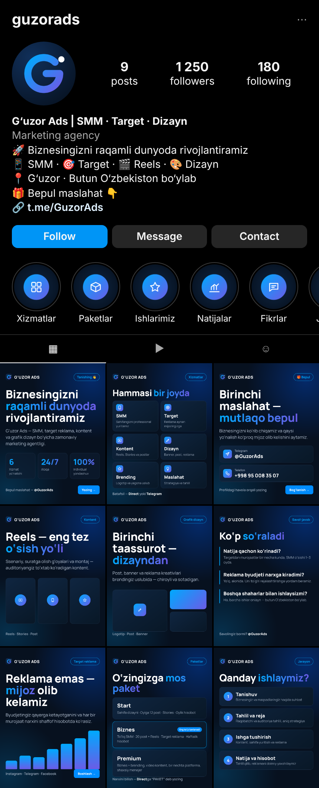

# G‘uzor Ads — Instagram upakovka

Instagram sahifasini to‘liq bezash uchun tayyor to‘plam: logo, bio, highlight muqovalari, birinchi 9 ta post va kontent reja.
Ranglar va shrift saytdagi bilan bir xil (`#07111f` fon, `#00aaff → #6c5ce7` gradient, Manrope).



## 1. Fayllar

| Fayl | Nima uchun |
|---|---|
| `export/logo-avatar.png` | Profil rasmi (1080×1080, doira kesimiga mos) |
| `export/logo-mark.png` | Shaffof fondagi belgi — video, stories, watermark uchun |
| `export/logo-full.png` | To‘liq logotip (Telegram, sayt, banner) |
| `export/highlights/*.png` | 8 ta highlight muqovasi (1080×1920) |
| `export/posts/post-1…9.png` | Birinchi 9 ta post (1080×1350, 4:5) |
| `preview.html` | Profil qanday ko‘rinishini ko‘rsatuvchi maket |

Matnni o‘zgartirish kerak bo‘lsa — `kit.html` ni tahrirlang va `node instagram/build.js` buyrug‘i bilan PNG larni qayta yarating.

## 2. Profil sozlamalari

**Username:** `@guzorads` (band bo‘lsa: `@guzor.ads`, `@guzorads.uz`)

**Ism (Name) maydoni** — Instagram qidiruvda shu maydonni ham o‘qiydi, shuning uchun kalit so‘zlar bilan:
```
G‘uzor Ads | SMM · Target · Dizayn
```

**Bio** (150 belgidan oshmaydi):
```
🚀 Biznesingizni raqamli dunyoda rivojlantiramiz
📱 SMM · 🎯 Target · 🎬 Reels · 🎨 Dizayn
📍 G‘uzor · Butun O‘zbekiston bo‘ylab
🎁 Bepul maslahat 👇
```

Muqobil variantlar:
```
📈 SMM va target reklama agentligi
✅ Sahifa yuritish · Reklama · Dizayn · Reels
📍 G‘uzor | onlayn — butun O‘zbekiston
💬 Bepul maslahat uchun yozing 👇
```
```
Reklama emas — mijoz olib kelamiz 🎯
SMM · Target · Kontent · Brending
📍 G‘uzor, Qashqadaryo
👇 Birinchi maslahat bepul
```

**Havola (Link):** `https://t.me/GuzorAds` — sayt joylangach, sayt havolasini ham qo‘shing (Instagram 5 tagacha havola qo‘yishga ruxsat beradi).

**Professional akkaunt:** Business → toifa (Category): **Marketing Agency**.

**Kontakt tugmalari:**
- Telefon: `+998 95 008 35 07`
- Manzil: G‘uzor, Qashqadaryo (ixtiyoriy)
- “Send message” tugmasi yoqilgan bo‘lsin

**Direct tez javoblari (Saved replies / FAQ):**
- `Narxlar qancha?` → “Narx biznesingiz ehtiyojiga qarab belgilanadi. Qisqacha biznesingiz haqida yozing — 15 daqiqada javob beramiz.”
- `PAKET` → paketlar postini yuboring + “Qaysi biri qiziqtirdi?”
- `Maslahat` → “Birinchi maslahat bepul! Telegram: @GuzorAds yoki raqamingizni qoldiring.”

## 3. Highlightlar (tartib bilan)

| # | Nomi | Muqova | Ichiga nima qo‘yiladi |
|---|---|---|---|
| 1 | Xizmatlar | `xizmatlar.png` | Har bir xizmat haqida 1 ta stories |
| 2 | Paketlar | `paketlar.png` | Start / Biznes / Premium |
| 3 | Ishlarimiz | `ishlar.png` | Dizayn va sahifa namunalari (oldin/keyin) |
| 4 | Natijalar | `natija.png` | Reklama kabinetidan skrinshotlar, raqamlar |
| 5 | Fikrlar | `fikrlar.png` | Mijozlar yozishmalari va video-fikrlar |
| 6 | Jarayon | `jarayon.png` | 4 qadam: tanishuv → reja → ishga tushirish → hisobot |
| 7 | Savollar | `savollar.png` | FAQ |
| 8 | Aloqa | `aloqa.png` | Telegram, telefon, manzil |

Highlight muqovasini qo‘yish: stories’ga muqova rasmini joylang → highlight’ga qo‘shing → **Edit highlight → Edit cover** dan tanlang.

## 4. Birinchi 9 ta post

Joylash tartibi (birinchi yuklangan pastda turadi): **4 → 5 → 6 → 7 → 8 → 9 → 3 → 2 → 1**.
Keyin `post-1`, `post-2`, `post-3` ni **Pin to profile** qiling — ular doim tepada turadi.

| Post | Mavzu | Tavsiya qilingan caption boshlanishi |
|---|---|---|
| 1 📌 | Biz kimmiz | “G‘uzor Ads bilan tanishing 👋 Biz bizneslarni internetda o‘stiramiz…” |
| 2 📌 | Xizmatlar | “Biznesingizga kerak bo‘lgan hamma narsa — bir joyda 👇” |
| 3 📌 | Bepul maslahat | “Birinchi maslahat — bepul 🎁 Direct’ga “MASLAHAT” deb yozing” |
| 4 | Ish jarayoni | “Biz bilan ishlash qanday bo‘ladi? 4 oddiy qadam…” |
| 5 | Paketlar | “Qaysi paket sizga mos? Direct’ga “PAKET” deb yozing” |
| 6 | Target reklama | “Reklama emas — mijoz olib kelamiz 🎯” |
| 7 | FAQ | “Eng ko‘p beriladigan 3 ta savolga javob” |
| 8 | Grafik dizayn | “Birinchi taassurot dizayndan boshlanadi 🎨” |
| 9 | Reels | “Reels — sahifani o‘stirishning eng tez yo‘li 🎬” |

## 5. Xeshteglar

```
#guzorads #guzor #qarshi #qashqadaryo #smm #smmuz #targetreklama #target_uz
#instagramreklama #marketinguz #biznesuz #dizayn #reels #brending #reklamauz
```
Har postga 5–10 ta mos xeshteg qo‘ying, hammasini birdan emas.

## 6. Haftalik kontent reja

| Kun | Format | Mavzu |
|---|---|---|
| Dushanba | Post (karusel) | Foydali maslahat: “Sahifangizda 5 ta xato” |
| Seshanba | Stories | So‘rovnoma, savol-javob |
| Chorshanba | Reels | Ish jarayonidan lavha / oldin-keyin |
| Payshanba | Post | Mijoz natijasi (keys) |
| Juma | Reels | Trend + marketing maslahat |
| Shanba | Stories | Jamoa, ofis, kundalik ish |
| Yakshanba | Post | Taklif / bepul maslahat CTA |

Stories — har kuni kamida 3–5 ta: biri foydali, biri ish jarayoni, biri CTA (“Direct’ga yozing”).
